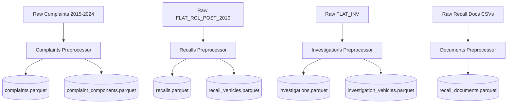

# DEFECTRADAR — Phase 2: Canonical Datasets Specification

**Project:** DEFECTRADAR — AI-Powered Early Detection of Emerging Vehicle Defects from Consumer Complaints  
**Phase:** Phase 2 (Canonical Data Preprocessing & Dataset Creation)  
**Date:** October 2026  
**Storage Format:** Apache Parquet (Snappy compression)  
**Storage Location:** `data/processed/`  
**Execution Environment:** macOS (Apple Silicon M2, 8GB Unified RAM)

---

## 1. Architectural Overview & Design Principles

The Phase 2 pipeline transforms 1.775 million raw NHTSA flat file records into seven clean, normalized, and validated Parquet datasets.

### Core Design Constraints Enforced:
1. **Zero Data Leakage:** Complaint records strictly preserve `received_date` as the ground-truth intake timestamp. No recall outcome flags, investigation milestones, or future information are attached to the complaints dataset.
2. **Streaming Chunk Processing:** All pipelines stream line-by-line using buffered I/O and batch writes (50,000 records) to keep resident memory consumption under 400 MB RAM at all times.
3. **Dual Representation:** Text, vehicle make, model, and component taxonomies retain both their raw values (`raw_*`) and sanitized/canonical forms (`normalized_*`).
4. **Relational Integrity:** Multi-component complaints are normalized into child records without dropping legitimate safety defect observations.

---

## 2. Canonical Datasets Detailed Specification

### 2.1 Dataset 1: `complaints.parquet`
- **File Location:** `data/processed/complaints.parquet`
- **Purpose:** Canonical entity table for all consumer safety complaints submitted to NHTSA between 2015 and 2024. Forms the primary input corpus for Phase 3 semantic clustering and temporal anomaly detection.
- **Primary Key:** `complaint_id` (NHTSA Case Number `ODINO`, unique per row).
- **Foreign Keys / Outgoing Relationships:**
  - `complaint_id` $\to$ `complaint_components.complaint_id` (1-to-many)
- **Field Schema:**
  - `complaint_id` (`string`, PK): Unique NHTSA complaint case identifier.
  - `manufacturer` (`string`): Corporate entity name.
  - `make_raw` (`string`): Original vehicle make string from raw file.
  - `make_normalized` (`string`): Standardized brand name (e.g. `HONDA`, `FORD`, `CHEVROLET`).
  - `model_raw` (`string`): Original vehicle model string from raw file.
  - `model_normalized` (`string`): Standardized model name without spacing noise.
  - `model_year` (`int32`): 4-digit model year ($1970 \le Y \le 2027$). Set to `NULL` for `9999` or out-of-range codes.
  - `received_date` (`date32`): Formal date complaint was received by NHTSA (`LDATE`). **Primary temporal index**.
  - `failure_date` (`date32`): Date defect occurred (`FAILDATE`). Cleaned of typo years (<1980) and future dates relative to `received_date`.
  - `date_added` (`date32`): System date added to NHTSA database (`DATEA`).
  - `complaint_text_raw` (`string`): Full unaltered consumer narrative (`CDESCR`).
  - `complaint_text_clean` (`string`): Sanitized text (NFKC unicode, control characters stripped, single-spaced, punctuation & technical terms preserved).
  - `narrative_length` (`int32`): Character count of the cleaned narrative.
  - `mileage` (`int64`): Odometer reading at incident (capped at 1,000,000 miles; outliers set to `NULL`).
  - `vehicle_speed` (`int32`): Approximate speed at incident in MPH (capped at 150 MPH).
  - `crash` (`bool`): `True` if vehicle was involved in a crash.
  - `fire` (`bool`): `True` if vehicle caught fire.
  - `injuries` (`int32`): Number of persons injured.
  - `deaths` (`int32`): Number of fatalities.
  - `medical_attention` (`bool`): `True` if medical attention was required.
  - `vehicle_towed` (`bool`): `True` if vehicle was towed from scene.
  - `product_type` (`string`): Product category code (`V` = Vehicle).
  - `vin_prefix` (`string`): First 11 characters of VIN (WMI + VDS).
  - `city` (`string`): Complainant city.
  - `state` (`string`): Complainant 2-letter US state code.
  - `source_period` (`string`): Partition label (`2015-2019` or `2020-2024`).
- **Aggregation Rules for Multi-Row ODINOs:**
  - *Text:* Longest non-empty narrative selected (identical in 99.99% of cases).
  - *Severity Booleans (`crash`, `fire`, `medical_attention`, `vehicle_towed`):* Logical `OR` (`True` if marked `'Y'` in any component row).
  - *Severity Counts (`injuries`, `deaths`):* `MAX` across component rows (prevents double-counting casualties across component lines).
  - *Mileage & Speed:* `MAX` valid numeric reading.
  - *Vehicle metadata:* First non-empty observation.

---

### 2.2 Dataset 2: `complaint_components.parquet`
- **File Location:** `data/processed/complaint_components.parquet`
- **Purpose:** Child entity table tracking individual component failure classifications reported for each complaint.
- **Primary Key:** `component_record_id` (NHTSA row sequence identifier `CMPLID`).
- **Foreign Key:** `complaint_id` $\to$ `complaints.complaint_id` (Many-to-1).
- **Field Schema:**
  - `component_record_id` (`string`, PK): Unique row identifier from NHTSA file.
  - `complaint_id` (`string`, FK): Associated complaint case identifier (`ODINO`).
  - `component_raw` (`string`): Unaltered raw component taxonomy string (`COMPDESC`).
  - `component_normalized` (`string`): Standardized uppercase string with normalized colon delimiters.
  - `component_system` (`string`): Top-level automotive system (e.g. `AIR BAGS`, `SERVICE BRAKES, HYDRAULIC`, `ENGINE AND ENGINE COOLING`).
  - `component_subsystem` (`string`): Specific assembly/subcomponent (e.g. `FRONTAL`, `ANTILOCK`, `EXHAUST SYSTEM`).
- **Cleaning & Normalization:**
  - Strips arbitrary spacing around colon separators (e.g. `"ENGINE : EXHAUST "` $\to$ `"ENGINE:EXHAUST"`).
  - Extracts primary system before first colon, subsystem after first colon.
  - Enforces 100% referential integrity with `complaints.parquet`.

---

### 2.3 Dataset 3: `recalls.parquet`
- **File Location:** `data/processed/recalls.parquet`
- **Purpose:** Canonical campaign-level ground truth table for all safety recalls issued post-2010.
- **Primary Key:** `campaign_number` (NHTSA Recall Campaign Number `CAMPNO`, e.g. `15V078000`).
- **Field Schema:**
  - `campaign_number` (`string`, PK): 9-character NHTSA campaign code.
  - `manufacturer` (`string`): Filing manufacturer name (`MFGNAME`).
  - `recall_date` (`date32`): Earliest Part 573 filing received date (`RCDATE`). **Ground-truth recall timestamp**.
  - `owner_notification_date` (`date32`): Earliest consumer notification date (`ODATE`).
  - `affected_units` (`int64`): Maximum estimated vehicle population affected (`POTAFF`).
  - `defect_description` (`string`): Full technical description of the safety defect (`DESC_DEFECT`).
  - `consequence` (`string`): Full description of the safety risk (`CONEQUENCE_DEFECT`).
  - `corrective_action` (`string`): Official corrective remedy summary (`CORRECTIVE_ACTION`).
  - `do_not_drive` (`bool`): `True` if urgent consumer "Do Not Drive" advisory was issued.
  - `park_outside` (`bool`): `True` if urgent "Park Outside" fire hazard advisory was issued.
  - `influenced_by` (`string`): Investigation origin (`MFR`, `ODI`, `OVSC`).
  - `record_count` (`int32`): Number of raw rows consolidated into this campaign.
- **Aggregation Rules:**
  - Groups all raw multi-model records sharing `CAMPNO`.
  - Consolidates descriptions by selecting the longest non-empty text.
  - Sets advisory booleans via logical `OR`.

---

### 2.4 Dataset 4: `recall_vehicles.parquet`
- **File Location:** `data/processed/recall_vehicles.parquet`
- **Purpose:** Child entity table tracking the specific vehicle makes, models, and model years affected by each safety recall campaign.
- **Foreign Key:** `campaign_number` $\to$ `recalls.campaign_number` (Many-to-1).
- **Field Schema:**
  - `campaign_number` (`string`, FK): Associated NHTSA campaign number.
  - `make_raw` (`string`): Raw make string.
  - `make_normalized` (`string`): Standardized make.
  - `model_raw` (`string`): Raw model string.
  - `model_normalized` (`string`): Cleaned model name.
  - `model_year` (`int32`): 4-digit affected model year ($1970 \le Y \le 2027$).
  - `component_raw` (`string`): Raw component string from recall file.
  - `component_normalized` (`string`): Normalized component string.
- **Deduplication:**
  - Deduplicated on composite key: `(campaign_number, make_normalized, model_normalized, model_year, component_normalized)`.
  - Zero orphan records: every vehicle variant maps to an existing campaign in `recalls.parquet`.

---

### 2.5 Dataset 5: `investigations.parquet`
- **File Location:** `data/processed/investigations.parquet`
- **Purpose:** Canonical table of formal defect investigations opened by NHTSA's Office of Defects Investigation (ODI). Serves as the intermediate validation milestone ($T_{\text{inv}}$).
- **Primary Key:** `investigation_id` (NHTSA Action Number, e.g. `PE21005`, `EA19002`).
- **Field Schema:**
  - `investigation_id` (`string`, PK): Unique investigation action number.
  - `action_type` (`string`): Investigation phase derived from prefix (`PE` = Preliminary Evaluation, `EA` = Engineering Analysis, `RQ` = Recall Query, `DP` = Defect Petition, `AQ` = Audit Query).
  - `opened_date` (`date32`): Date investigation was opened (`ODATE`). **Primary investigation milestone**.
  - `closed_date` (`date32`): Date investigation was closed (`CDATE`). `NULL` if still open.
  - `recall_campaign_number` (`string`, FK): Resulting recall campaign number (`CAMPNO`), if defect was confirmed.
  - `subject` (`string`): Headline summary of alleged defect.
  - `summary` (`string`): In-depth engineering summary of the investigation.
  - `manufacturer` (`string`): Target manufacturer name.
  - `record_count` (`int32`): Number of raw rows consolidated into this investigation.
- **Aggregation Rules:**
  - Groups raw rows by `NHTSA_ACTION_NUMBER`.
  - Preserves earliest `opened_date` and latest `closed_date`.
  - Retains longest non-empty `subject` and `summary`.

---

### 2.6 Dataset 6: `investigation_vehicles.parquet`
- **File Location:** `data/processed/investigation_vehicles.parquet`
- **Purpose:** Child entity table tracking the specific vehicle makes, models, model years, and components covered by each defect investigation.
- **Foreign Key:** `investigation_id` $\to$ `investigations.investigation_id` (Many-to-1).
- **Field Schema:**
  - `investigation_id` (`string`, FK): Associated NHTSA action number.
  - `make_raw` (`string`): Raw make string.
  - `make_normalized` (`string`): Standardized make.
  - `model_raw` (`string`): Raw model string.
  - `model_normalized` (`string`): Cleaned model name.
  - `model_year` (`int32`): Model year investigated.
  - `component_raw` (`string`): Raw component string.
  - `component_normalized` (`string`): Normalized component string.
  - `manufacturer` (`string`): Target manufacturer.

---

### 2.7 Dataset 7: `recall_documents.parquet`
- **File Location:** `data/processed/recall_documents.parquet`
- **Purpose:** Supplementary engineering documentation table capturing manufacturer recall notices, technical service bulletins, and field remedy procedures.
- **Field Schema:**
  - `nhtsa_id` (`string`): Shortened campaign code prefix (e.g. `15V078`).
  - `document_name` (`string`): PDF docket filename (e.g. `RCRIT-15V078-1234.pdf`).
  - `document_type` (`string`): Document category derived from prefix (`RCMN` = OEM Notice, `RCRIT` = Field Remedy Instructions, `RCONL` = Consumer Notice Letter).
  - `make_raw` (`string`): Make.
  - `make_normalized` (`string`): Standardized make.
  - `model_raw` (`string`): Model.
  - `model_normalized` (`string`): Cleaned model.
  - `model_year` (`int32`): Model year.
  - `summary` (`string`): Document description text.
  - `source_period` (`string`): `2015-2019` or `2020-2024`.

---

## 3. Data Cleaning & Normalization Reference Matrix

| Dimension | Raw Condition | Transformation Applied | Canonical Field |
| :--- | :--- | :--- | :--- |
| **Dates** | `YYYYMMDD` string (e.g. `20191221`) | Strict integer parsing, ISO date conversion, range validation $[1900, 2030]$ | `date32` type |
| **Failure Dates** | Consumer typos (e.g. `1906`, future dates) | Outlier rejection: Year $\ge 1980$, date $\le$ `received_date` | `failure_date` (nullable) |
| **Text** | All-caps, newlines, tabs, control characters | Unicode NFKC normalization, control char removal, whitespace collapsing | `complaint_text_clean` |
| **Severity Booleans** | String `'Y'` / `'N'` / blank | Binary boolean mapping; logical OR across multi-component rows | `crash`, `fire`, `medical_attention`, `vehicle_towed` |
| **Severity Counts** | String integers; blank = 0 | Safe numeric parsing; `MAX` aggregation across multi-component rows | `injuries`, `deaths` |
| **Vehicle Make** | Inconsistent corporate aliases | Uppercase trimming + dictionary normalization (`HONDA MOTOR CO.` $\to$ `HONDA`) | `make_normalized` |
| **Vehicle Model** | Variations in spacing | Uppercase trimming, interior whitespace collapsing | `model_normalized` |
| **Component String** | Complex nested colon hierarchies | Spacing cleanup around colons, primary system & subsystem extraction | `component_normalized`, `component_system`, `component_subsystem` |
| **Model Year** | String with codes like `9999` (unknown) | Valid integer $[1970, 2027]$; `9999` mapped to `NULL` | `model_year` |
