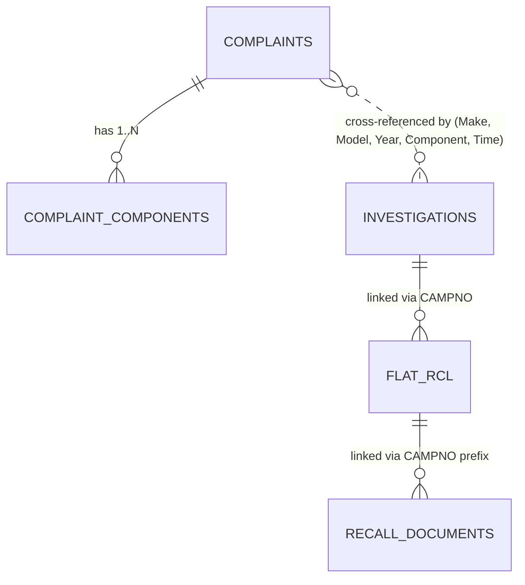

# DEFECTRADAR — Phase 1: Comprehensive Data Audit

**Project:** DEFECTRADAR — AI-Powered Early Detection of Emerging Vehicle Defects from Consumer Complaints  
**Author:** Final Year Project Team  
**Date:** October 2026  
**Environment:** macOS (Apple Silicon M2, 8GB Unified RAM)  
**Status:** Phase 1 Complete (Data Foundation & Audit)

---

## 1. Executive Summary & Inventory

The project utilizes six official National Highway Traffic Safety Administration (NHTSA) datasets located in `data/raw/`. All datasets were analyzed via chunked and buffered stream processing to maintain low memory usage (<200MB resident memory during execution).

| Dataset Archive | Extracted Filename | Format | Delimiter | Header | Compressed Size | Uncompressed Size | Total Records | Columns |
| :--- | :--- | :--- | :--- | :--- | :--- | :--- | :--- | :--- |
| `COMPLAINTS_RECEIVED_2015-2019.zip` | `COMPLAINTS_RECEIVED_2015-2019.txt` | Flat text | Tab (`\t`) | **No** | 77.53 MB | 340.75 MB | 489,809 | 51 |
| `COMPLAINTS_RECEIVED_2020-2024.zip` | `COMPLAINTS_RECEIVED_2020-2024.txt` | Flat text | Tab (`\t`) | **No** | 72.36 MB | 311.56 MB | 418,884 | 51 |
| `FLAT_INV.zip` | `FLAT_INV.txt` | Flat text | Tab (`\t`) | **No** | 4.10 MB | 372.49 MB | 154,401 | 11 |
| `FLAT_RCL_POST_2010.zip` | `FLAT_RCL_POST_2010.txt` | Flat text | Tab (`\t`) | **No** | 14.27 MB | 296.90 MB | 245,651 | 29 |
| `RCL_FROM_2015_2019.zip` | `RCL_FROM_2015_2019.csv` | CSV | Comma (`,`) | **Yes** | 6.16 MB | 83.45 MB | 250,050 | 6 |
| `RCL_FROM_2020_2024.zip` | `RCL_FROM_2020_2024.csv` | CSV | Comma (`,`) | **Yes** | 3.83 MB | 64.35 MB | 216,208 | 6 |
| **Total** | | | | | **178.25 MB** | **1,469.50 MB** | **1,775,003** | — |

---

## 2. Dataset-by-Dataset Detailed Audit

### 2.1 Dataset 1: Consumer Complaints (2015–2019)
- **File Name:** `COMPLAINTS_RECEIVED_2015-2019.txt`
- **Compressed Size:** 81,302,724 bytes (77.53 MB)
- **Uncompressed Size:** 357,305,037 bytes (340.75 MB)
- **Record Count:** 489,809 rows
- **Column Count:** 51 columns (Tab-delimited, no header row)
- **Key Identifiers:**
  - `CMPLID` (Sequence ID): 489,809 unique (100% unique per row)
  - `ODINO` (NHTSA Case Number): 359,263 unique complaints
- **Duplicate & Component Granularity Analysis:**
  - One complaint (`ODINO`) can be associated with multiple component failure codes.
  - Multi-row complaints: 94,490 ODINOs appear in >1 row.
  - Multi-component complaints: 93,443 ODINOs report >1 distinct component.
  - Maximum components per single complaint: 17 components.
  - **Critical Rule:** Deduplication on `ODINO` alone drops 130,546 component observations. Each row represents a `(Complaint, Component)` pair.
- **Date Ranges & Validity:**
  - Received Date (`LDATE`): `2015-01-01` to `2019-12-31` (100% valid dates, 0 missing).
  - Incident/Failure Date (`FAILDATE`): `1906-06-22` to `2019-12-31` (99.99% valid dates; 61 records with historic/typo years like 1906, 1910).
  - Date Added (`DATEA`): `1997-06-27` to `2020-01-14` (0 missing).
- **Severity & Safety Indicators:**
  - Crashes (`CRASH`): 28,108 cases marked 'Y' (5.74%), 461,701 marked 'N'.
  - Fires (`FIRE`): 11,380 cases marked 'Y' (2.32%), 478,429 marked 'N'.
  - Total Injuries Reported (`INJURED`): 24,853 persons.
  - Total Fatalities Reported (`DEATHS`): 1,087 deaths.
- **Product Classification:**
  - Vehicles (`V`): 485,082 (99.03%)
  - Tires (`T`): 2,514 (0.51%)
  - Equipment (`E`): 1,210 (0.25%)
  - Child Restraint (`C`): 995 (0.20%)
  - Missing: 8 rows
- **Top Vehicle Makes:**
  1. FORD: 79,320 rows (16.19%)
  2. CHEVROLET: 53,286 rows (10.88%)
  3. DODGE: 37,343 rows (7.62%)
  4. JEEP: 35,589 rows (7.27%)
  5. TOYOTA: 35,242 rows (7.20%)
- **Top Defect Components:**
  1. AIR BAGS: 73,006 rows (14.90%)
  2. ELECTRICAL SYSTEM: 58,988 rows (12.04%)
  3. ENGINE: 55,304 rows (11.29%)
  4. POWER TRAIN: 41,796 rows (8.53%)
  5. UNKNOWN OR OTHER: 40,486 rows (8.27%)
- **Narrative Text (`CDESCR`) Availability & Quality:**
  - Empty Narratives: Only 4 rows (<0.001%)
  - Median Narrative Length: 455 characters (~75–100 words)
  - 90th Percentile Length: 1,119 characters (~180–220 words)
  - Mean Narrative Length: 556 characters
  - Content Quality: High descriptive richness detailing vehicle speed, driving scenario, warning lights, failure symptoms, and dealer interactions.
- **Missing Value Patterns:**
  - `CMPLID`, `ODINO`, `CRASH`, `FIRE`, `INJURED`, `DEATHS`, `CITY`, `STATE`, `LDATE`, `DATEA`: 0% missing.
  - `MAKETXT`, `MODELTXT`, `YEARTXT`, `MFR_NAME`: 8 rows missing (<0.002%).
  - `VIN`: 45,597 missing (9.31%).
  - `MILES` (Mileage at failure): 118,053 missing (24.10%).
  - Technical engineering sub-attributes (`NUM_CYLS`, `DRIVE_TRAIN`, `FUEL_SYS`, `TRANS_TYPE`): >85% missing (consumer optional fields).
- **Data-Quality Issues Identified:**
  - Typographical outliers in `FAILDATE` (e.g., year 1906).
  - Unstandardized component names with nested colon structures (`ENGINE AND ENGINE COOLING:EXHAUST SYSTEM`).
  - Uppercase consumer text narratives containing sporadic punctuation artifacts.
- **Recommended Role in DefectRadar:**
  - **Core primary dataset for baseline period (2015–2019)**. Supplies raw consumer symptom narratives, temporal timestamps, safety severity flags, and vehicle make/model hierarchies.

---

### 2.2 Dataset 2: Consumer Complaints (2020–2024)
- **File Name:** `COMPLAINTS_RECEIVED_2020-2024.txt`
- **Compressed Size:** 75,873,879 bytes (72.36 MB)
- **Uncompressed Size:** 326,690,376 bytes (311.56 MB)
- **Record Count:** 418,884 rows
- **Column Count:** 51 columns (Tab-delimited, no header row)
- **Key Identifiers:**
  - `CMPLID`: 418,884 unique (100% unique per row)
  - `ODINO`: 291,999 unique complaints
- **Duplicate & Component Granularity Analysis:**
  - Multi-row complaints: 90,347 ODINOs appear in >1 row.
  - Multi-component complaints: 88,185 ODINOs report >1 distinct component.
  - Maximum components per single complaint: 9 components.
  - ODINO overlap with 2015–2019 dataset: **0** (strictly disjoint across receipt periods).
- **Date Ranges & Validity:**
  - Received Date (`LDATE`): `2020-01-01` to `2024-12-31` (100% valid, 0 missing).
  - Incident/Failure Date (`FAILDATE`): `1917-01-01` to `2024-12-31` (100% valid format).
  - Date Added (`DATEA`): `2019-12-30` to `2025-01-06` (0 missing).
- **Severity & Safety Indicators:**
  - Crashes (`CRASH`): 19,125 cases marked 'Y' (4.57%), 399,759 marked 'N'.
  - Fires (`FIRE`): 8,015 cases marked 'Y' (1.91%), 410,869 marked 'N'.
  - Total Injuries Reported (`INJURED`): 16,217 persons.
  - Total Fatalities Reported (`DEATHS`): 1,407 deaths.
- **Product Classification:**
  - Vehicles (`V`): 413,239 (98.65%)
  - Tires (`T`): 3,091 (0.74%)
  - Equipment (`E`): 1,696 (0.40%)
  - Child Restraint (`C`): 851 (0.20%)
  - Missing: 7 rows
- **Top Vehicle Makes:**
  1. FORD: 72,114 rows (17.22%)
  2. CHEVROLET: 36,753 rows (8.77%)
  3. HONDA: 32,109 rows (7.67%)
  4. HYUNDAI: 26,760 rows (6.39%)
  5. JEEP: 26,193 rows (6.25%)
- **Top Defect Components:**
  1. ENGINE: 59,770 rows (14.27%)
  2. ELECTRICAL SYSTEM: 48,954 rows (11.69%)
  3. UNKNOWN OR OTHER: 41,033 rows (9.80%)
  4. POWER TRAIN: 38,004 rows (9.07%)
  5. STEERING: 28,889 rows (6.90%)
  *(Note shift: Air bags dropped out of top 5, replaced by Engine and Steering).*
- **Narrative Text (`CDESCR`) Availability & Quality:**
  - Empty Narratives: 0 rows (100% have narrative text).
  - Median Narrative Length: 496 characters.
  - 90th Percentile Length: 1,167 characters.
  - Mean Narrative Length: 585 characters.
- **Missing Value Patterns:**
  - `CMPLID`, `ODINO`, `CRASH`, `FIRE`, `INJURED`, `DEATHS`, `CITY`, `STATE`, `LDATE`, `DATEA`, `CDESCR`: 0% missing.
  - `MAKETXT`, `MODELTXT`, `YEARTXT`, `MFR_NAME`: 7 rows missing.
  - `VIN`: 9,437 missing (2.25%).
  - `MILES`: 268,824 missing (64.18%).
- **Recommended Role in DefectRadar:**
  - **Core primary dataset for evaluation and emerging defect discovery (2020–2024)**. Paired with 2015–2019 to provide continuous 10-year defect evolution.

---

### 2.3 Dataset 3: NHTSA Defect Investigations (`FLAT_INV`)
- **File Name:** `FLAT_INV.txt`
- **Compressed Size:** 4,300,161 bytes (4.10 MB)
- **Uncompressed Size:** 390,581,284 bytes (372.49 MB)
- **Record Count:** 154,401 rows
- **Column Count:** 11 columns (Tab-delimited, no header row)
- **Key Identifiers:**
  - `NHTSA_ACTION_NUMBER`: 5,349 unique formal investigations.
  - `CAMPNO` (Linked Recall Campaign): Present in 125,719 rows (81.42%), representing 2,822 unique recall campaigns.
- **Investigation Type Breakdown:**
  - `EA` (Engineering Analysis): 90,647 rows (58.71%)
  - `PE` (Preliminary Evaluation): 39,104 rows (25.33%)
  - `DP` (Defect Petition): 12,577 rows (8.15%)
  - `EQ` (Equipment Query): 5,300 rows (3.43%)
  - `RQ` (Recall Query): 3,897 rows (2.52%)
  - `AQ` (Audit Query): 2,027 rows (1.31%)
  - Other (`SQ`, `C`, `RP`, `ID`): 849 rows
- **Date Ranges:**
  - Investigation Open Date (`ODATE`): `1972-03-10` to `2026-09-21`
  - Investigation Close Date (`CDATE`): `1972-05-30` to `2026-09-24` (75,625 currently open or closed without explicit date)
- **Top Vehicle Makes in Investigations:**
  1. HONDA: 16,597 rows
  2. DODGE: 13,462 rows
  3. KIA: 12,796 rows
  4. FORD: 10,384 rows
  5. BMW: 9,880 rows
- **Top Investigated Components:**
  1. AIR BAGS: 37,857 rows
  2. AIR BAGS:FRONTAL: 37,679 rows
  3. SERVICE BRAKES, HYDRAULIC: 2,526 rows
  4. ELECTRICAL SYSTEM: 2,459 rows
  5. VEHICLE SPEED CONTROL: 2,329 rows
- **Data-Quality Issues:**
  - One investigation action number maps to multiple make/model/year rows (denormalized vehicle coverage).
  - `CDATE` is null for ongoing open investigations.
- **Recommended Role in DefectRadar:**
  - **Ground truth milestone dataset**. Serves as the primary validation target for early defect detection. An emerging cluster in complaints can be evaluated against the date NHTSA officially opened an investigation (`ODATE`).

---

### 2.4 Dataset 4: Safety Recalls Post-2010 (`FLAT_RCL_POST_2010`)
- **File Name:** `FLAT_RCL_POST_2010.txt`
- **Compressed Size:** 14,964,935 bytes (14.27 MB)
- **Uncompressed Size:** 311,321,627 bytes (296.90 MB)
- **Record Count:** 245,651 rows
- **Column Count:** 29 columns (Tab-delimited, no header row)
- **Key Identifiers:**
  - `RECORD_ID`: 245,651 unique sequence records.
  - `CAMPNO` (NHTSA Recall Campaign Number): 15,286 unique safety recall campaigns.
- **Multi-Model Campaign Granularity:**
  - Campaigns spanning multiple vehicle models/years: 10,786 campaigns (70.56%).
  - Maximum vehicle variants in a single campaign: 727 distinct `(Make, Model, Year)` records (e.g., massive Takata airbag campaigns or platform-wide electrical recalls).
  - **Key Finding:** `CAMPNO` is NOT 1-to-1 with table rows; one campaign covers dozens of affected vehicles and components.
- **Date Ranges:**
  - Report Received Date (`RCDATE`): `2010-01-01` to `2026-09-30`
  - Owner Notification Date (`ODATE`): `1980-12-31` to `2027-08-16` (3,926 missing)
- **Recall Initiation Influence (`INFLUENCED_BY`):**
  - `MFR` (Manufacturer Initiated): 215,148 rows (87.58%)
  - `ODI` (Influenced by NHTSA Office of Defects Investigation): 28,644 rows (11.66%)
  - `OVSC` (Office of Vehicle Safety Compliance): 1,858 rows (0.76%)
- **Product Classification:**
  - Vehicles (`V`): 218,912 rows (89.12%)
  - Tires (`T`): 20,282 rows (8.26%)
  - Equipment (`E`): 5,995 rows (2.44%)
  - Child Restraint (`C`): 462 rows (0.19%)
- **Rich Text Fields:**
  - `DESC_DEFECT` (Defect Summary): 0 missing (100% complete)
  - `CONEQUENCE_DEFECT` (Consequence Summary): 0 missing (100% complete)
  - `CORRECTIVE_ACTION` (Remedy Summary): 0 missing (100% complete)
- **Recommended Role in DefectRadar:**
  - **Ground truth outcome dataset**. Used for backtesting whether an emerging cluster preceded the official recall date (`RCDATE`), and semantic validation comparing complaint cluster narratives with the official manufacturer `DESC_DEFECT`.

---

### 2.5 Dataset 5: Recall Associated Documents (2015–2019)
- **File Name:** `RCL_FROM_2015_2019.csv`
- **Compressed Size:** 6,460,427 bytes (6.16 MB)
- **Uncompressed Size:** 87,504,479 bytes (83.45 MB)
- **Record Count:** 250,050 rows
- **Column Count:** 6 columns (Comma-separated, standard quotes, has header row)
- **Columns:** `NHTSA ID`, `DOCUMENT NAME`, `MAKE`, `MODEL`, `MODEL YEAR`, `SUMMARY`
- **Granularity & Contents:**
  - Unique Recall Campaigns (`NHTSA ID`): 2,629 campaigns (e.g., `15V123`).
  - Unique Document Names: 18,332 PDF filings.
  - Document Classifications:
    - `RCMN` (Manufacturer Recall Notices): 101,197 rows
    - `RCRIT` (Field Remedy Instructions & Technical Service Bulletins): 56,102 rows
    - `RCONL` (Part 577 Consumer Notification Letters): 31,512 rows
    - `RMISC` (Miscellaneous technical correspondence): 26,051 rows
    - `RCRN` (Recall Acknowledgement letters): 24,637 rows
- **Data Quality:** High. Only 20 rows missing `SUMMARY`.
- **Recommended Role in DefectRadar:**
  - **Supplementary technical validation dataset**. Supplies in-depth OEM technical service bulletin summaries and field remedy procedures when validating cluster explanations.

---

### 2.6 Dataset 6: Recall Associated Documents (2020–2024)
- **File Name:** `RCL_FROM_2020_2024.csv`
- **Compressed Size:** 4,013,024 bytes (3.83 MB)
- **Uncompressed Size:** 67,470,970 bytes (64.35 MB)
- **Record Count:** 216,208 rows
- **Column Count:** 6 columns (Comma-separated, standard quotes, has header row)
- **Columns:** `NHTSA ID`, `DOCUMENT NAME`, `MAKE`, `MODEL`, `MODEL YEAR`, `SUMMARY`
- **Granularity & Contents:**
  - Unique Recall Campaigns (`NHTSA ID`): 3,583 campaigns.
  - Unique Document Names: 21,635 PDF filings.
  - Document Classifications: `RCMN` (70,333), `RCRIT` (62,204), `RCONL` (33,335), `RMISC` (18,971), `RCRN` (15,675), `RIONL` (9,604), `RCSB` (5,116).
- **Data Quality:** 100% complete. 0 missing values across all columns.
- **Recommended Role in DefectRadar:**
  - **Supplementary technical validation dataset** for recent campaigns (2020–2024).

---

## 3. Cross-Dataset Comparison & Interlinkage Matrix

| Linkage Pathway | Primary Key / Foreign Key | Matching Strategy | Quality / Completeness |
| :--- | :--- | :--- | :--- |
| **Complaint to Component** | `ODINO` $\to$ `COMPDESC` | 1-to-Many relational split | 100% deterministic (no data loss) |
| **Investigation to Recall** | `FLAT_INV.CAMPNO` $\to$ `FLAT_RCL.CAMPNO` | Exact alphanumeric string match | 81.42% of investigation rows carry valid `CAMPNO` |
| **Recall to Recall Documents** | `FLAT_RCL.CAMPNO`[:6] $\to$ `RCL_DOCS.NHTSA ID` | Prefix match (e.g. `15V078000` $\to$ `15V078`) | High coverage for major consumer recalls |
| **Complaints to Recalls/Invs** | `(MAKE, MODEL, YEAR)` + Semantic Similarity + Temporal bounds | Probabilistic cluster backtest (Strictly $T_{\text{complaint}} < T_{\text{recall}}$) | Zero data leakage required |
