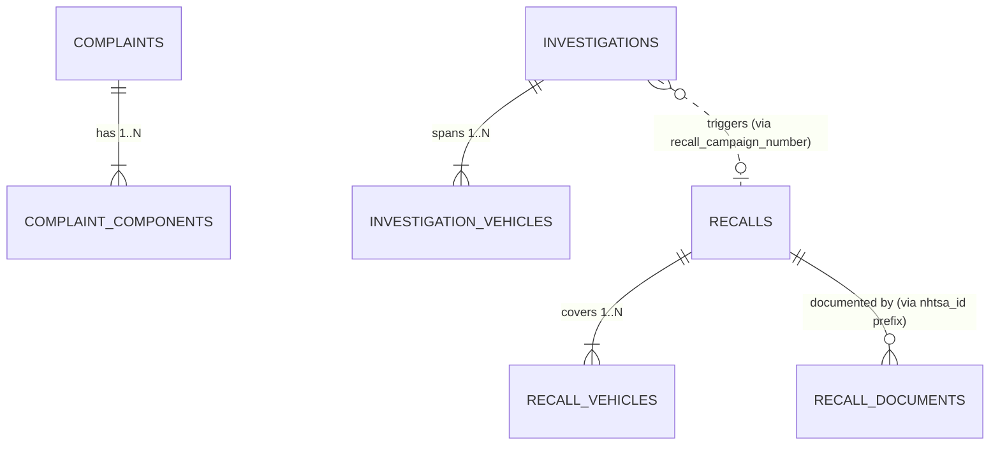

# DEFECTRADAR — Canonical Data Model Specification

**Phase:** Phase 2 Canonical Preprocessing & Implementation  
**Status:** Implemented in Parquet (`data/processed/`)  
**Target Storage Engine:** Apache Parquet with Snappy compression  
**Hardware Optimization:** Streamed in 50,000-record chunks (<500MB resident memory on Apple Silicon M2, 8GB RAM).

---

## 1. Relational Entity Relationship Diagram

The canonical schema normalizes the raw denormalized NHTSA flat files into seven clean relational entities to eliminate data duplication, maintain 1-to-many relationships (e.g. multi-component complaints and multi-model recall campaigns), and support strict temporal filtering without data leakage.

**Source attribution:** NHTSA field names and source-file definitions are from the [official complaint flat-file layout](https://static.nhtsa.gov/odi/ffdd/cmpl/CMPL.txt); the broader inventory and investigation/recall references are linked in [the data audit](data_audit.md) and [data dictionary](data_dictionary.md). The normalized entities, constraints, field mappings, and temporal-analysis choices below are project-authored explanations, not NHTSA definitions. This is schema documentation only; no individual complaint values or narratives are reproduced.

**Campaign-number representation:** Preprocessing stores `CAMPNO` values from the investigation and recall sources as strings after trimming surrounding whitespace and uppercasing. It does not pad or truncate values to the sources' different declared widths; see the [data dictionary](data_dictionary.md).

---

## 2. Table Specifications (Implemented Phase 2 Schema)

### 2.1 Table: `complaints` (`complaints.parquet`)
Represents a unique consumer complaint case filed with NHTSA. Every complaint appears exactly once.

| Column | Type | Nullable | Source Field | Description |
| :--- | :--- | :--- | :--- | :--- |
| `complaint_id` | `VARCHAR` | **No** (PK) | `ODINO` | Primary Key: NHTSA case reference number. |
| `manufacturer` | `VARCHAR` | Yes | `MFR_NAME` | Corporate manufacturer name. |
| `make_raw` | `VARCHAR` | Yes | `MAKETXT` | Unaltered raw make string. |
| `make_normalized` | `VARCHAR` | Yes | `MAKETXT` | Standardized uppercase make (aliases resolved). |
| `model_raw` | `VARCHAR` | Yes | `MODELTXT` | Unaltered raw model string. |
| `model_normalized`| `VARCHAR` | Yes | `MODELTXT` | Standardized model string without spacing noise. |
| `model_year` | `INT` | Yes | `YEARTXT` | Integer model year ($1970 \le Y \le 2027$; `9999` $\to$ NULL). |
| `received_date` | `DATE` | **No** | `LDATE` | Date NHTSA received the complaint (`YYYY-MM-DD`). **Primary temporal index for all DefectRadar temporal analysis and backtesting**. |
| `failure_date` | `DATE` | Yes | `FAILDATE` | Date defect incident occurred ($\le$ `received_date`, $\ge 1980$). |
| `date_added` | `DATE` | Yes | `DATEA` | NHTSA date-added-to-file value; retained as provenance, not as the primary analysis timestamp. |
| `complaint_text_raw`| `VARCHAR` | Yes | `CDESCR` | Unaltered raw consumer narrative. |
| `complaint_text_clean`| `VARCHAR`| Yes | `CDESCR` | Sanitized narrative (unicode NFKC, control chars removed, single-spaced). |
| `narrative_length` | `INT` | No | Derived | Character count of `complaint_text_clean`. |
| `mileage` | `BIGINT` | Yes | `MILES` | Vehicle odometer reading at failure ($\le 1,000,000$). |
| `vehicle_speed` | `INT` | Yes | `VEH_SPEED` | Approximate vehicle speed at incident in MPH ($\le 150$). |
| `crash` | `BOOLEAN` | No | `CRASH` | `True` if marked `'Y'` in any component row. |
| `fire` | `BOOLEAN` | No | `FIRE` | `True` if marked `'Y'` in any component row. |
| `injuries` | `INT` | No | `INJURED` | Maximum injury count across component rows. |
| `deaths` | `INT` | No | `DEATHS` | Maximum fatality count across component rows. |
| `medical_attention`| `BOOLEAN`| No | `MEDICAL_ATTN`| `True` if medical attention was required. |
| `vehicle_towed` | `BOOLEAN` | No | `VEHICLES_TOWED_YN`| `True` if vehicle was towed. |
| `product_type` | `VARCHAR` | No | `PROD_TYPE` | Filtered product type code (`V` = Vehicle). |
| `vin_prefix` | `VARCHAR` | Yes | `VIN` | First 11 characters of VIN. |
| `city` | `VARCHAR` | Yes | `CITY` | Complainant city. |
| `state` | `VARCHAR` | Yes | `STATE` | 2-letter US state code. |
| `source_period` | `VARCHAR` | No | Partition | `2015-2019` or `2020-2024`. |

---

### 2.2 Table: `complaint_components` (`complaint_components.parquet`)
Child entity table maintaining component failure classifications for each complaint.

| Column | Type | Nullable | Source Field | Description |
| :--- | :--- | :--- | :--- | :--- |
| `component_record_id` | `VARCHAR` | **No** (PK) | `CMPLID` | NHTSA unique row sequence number. |
| `complaint_id` | `VARCHAR` | **No** (FK) | `ODINO` | Foreign Key referencing `complaints.complaint_id`. |
| `component_raw` | `VARCHAR` | Yes | `COMPDESC` | Unaltered raw NHTSA component string. |
| `component_normalized`| `VARCHAR` | Yes | `COMPDESC` | Standardized component string with normalized colon spacing. |
| `component_system` | `VARCHAR` | Yes | Derived | High-level system category (before first colon). |
| `component_subsystem` | `VARCHAR` | Yes | Derived | Secondary assembly/part (after first colon). |

---

### 2.3 Table: `recalls` (`recalls.parquet`)
Canonical safety recall campaign table (1 row per `CAMPNO`).

| Column | Type | Nullable | Source Field | Description |
| :--- | :--- | :--- | :--- | :--- |
| `campaign_number` | `VARCHAR` | **No** (PK) | `CAMPNO` | Unique NHTSA Recall Campaign Number. |
| `manufacturer` | `VARCHAR` | Yes | `MFGNAME` | Filing manufacturer. |
| `recall_date` | `DATE` | **No** | `RCDATE` | Earliest Part 573 report received date. **Ground-truth recall timestamp**. |
| `owner_notification_date`| `DATE` | Yes | `ODATE` | Earliest consumer notification date. |
| `affected_units` | `BIGINT` | No | `POTAFF` | Maximum estimated units affected. |
| `defect_description` | `VARCHAR` | Yes | `DESC_DEFECT` | Longest non-empty technical defect summary. |
| `consequence` | `VARCHAR` | Yes | `CONEQUENCE_DEFECT`| Longest non-empty safety consequence summary. |
| `corrective_action` | `VARCHAR` | Yes | `CORRECTIVE_ACTION`| Longest non-empty remedy summary. |
| `do_not_drive` | `BOOLEAN` | No | `DO_NOT_DRIVE` | `True` if urgent "Do Not Drive" advisory issued. |
| `park_outside` | `BOOLEAN` | No | `PARK_OUTSIDE` | `True` if urgent "Park Outside" fire hazard advisory issued. |
| `influenced_by` | `VARCHAR` | Yes | `INFLUENCED_BY` | Originator code: `MFR`, `ODI`, or `OVSC`. |
| `record_count` | `INT` | No | Derived | Total raw records consolidated into this campaign. |

---

### 2.4 Table: `recall_vehicles` (`recall_vehicles.parquet`)
Child table mapping recall campaigns to affected vehicle variants.

| Column | Type | Nullable | Source Field | Description |
| :--- | :--- | :--- | :--- | :--- |
| `campaign_number` | `VARCHAR` | **No** (FK) | `CAMPNO` | Foreign key referencing `recalls.campaign_number`. |
| `make_raw` | `VARCHAR` | Yes | `MAKETXT` | Raw make string. |
| `make_normalized` | `VARCHAR` | Yes | `MAKETXT` | Standardized make. |
| `model_raw` | `VARCHAR` | Yes | `MODELTXT` | Raw model string. |
| `model_normalized` | `VARCHAR` | Yes | `MODELTXT` | Standardized model string. |
| `model_year` | `INT` | Yes | `YEARTXT` | Affected model year. |
| `component_raw` | `VARCHAR` | Yes | `COMPNAME` | Raw component description. |
| `component_normalized`| `VARCHAR` | Yes | `COMPNAME` | Normalized component description. |

---

### 2.5 Table: `investigations` (`investigations.parquet`)
Canonical defect investigations opened by NHTSA's Office of Defects Investigation.

| Column | Type | Nullable | Source Field | Description |
| :--- | :--- | :--- | :--- | :--- |
| `investigation_id` | `VARCHAR` | **No** (PK) | `NHTSA_ACTION_NUMBER` | Unique investigation ID. |
| `action_type` | `VARCHAR` | No | Derived | Investigation tier (`PE`, `EA`, `RQ`, `DP`, `AQ`, `EQ`). |
| `opened_date` | `DATE` | Yes | `ODATE` | Date investigation opened. **Primary investigation milestone**. |
| `closed_date` | `DATE` | Yes | `CDATE` | Date investigation closed (`NULL` if still open). |
| `recall_campaign_number`| `VARCHAR`| Yes (FK)| `CAMPNO` | Foreign Key to `recalls.campaign_number` if resulted in a recall. |
| `subject` | `VARCHAR` | Yes | `SUBJECT` | Headline description of alleged defect. |
| `summary` | `VARCHAR` | Yes | `SUMMARY` | In-depth engineering summary. |
| `manufacturer` | `VARCHAR` | Yes | `MFR_NAME` | Manufacturer under investigation. |
| `record_count` | `INT` | No | Derived | Total raw records consolidated into this investigation. |

---

### 2.6 Table: `investigation_vehicles` (`investigation_vehicles.parquet`)
Child table mapping investigations to target vehicle models and components.

| Column | Type | Nullable | Source Field | Description |
| :--- | :--- | :--- | :--- | :--- |
| `investigation_id` | `VARCHAR` | **No** (FK) | `NHTSA_ACTION_NUMBER` | Foreign key referencing `investigations.investigation_id`. |
| `make_raw` | `VARCHAR` | Yes | `MAKE` | Raw make string. |
| `make_normalized` | `VARCHAR` | Yes | `MAKE` | Standardized make. |
| `model_raw` | `VARCHAR` | Yes | `MODEL` | Raw model string. |
| `model_normalized` | `VARCHAR` | Yes | `MODEL` | Standardized model string. |
| `model_year` | `INT` | Yes | `YEAR` | Model year investigated. |
| `component_raw` | `VARCHAR` | Yes | `COMPNAME` | Raw component string. |
| `component_normalized`| `VARCHAR` | Yes | `COMPNAME` | Normalized component string. |
| `manufacturer` | `VARCHAR` | Yes | `MFR_NAME` | Manufacturer string. |

---

### 2.7 Table: `recall_documents` (`recall_documents.parquet`)
Supplementary table for recall-associated technical service bulletins, field action instructions, and OEM notices.

| Column | Type | Nullable | Source Field | Description |
| :--- | :--- | :--- | :--- | :--- |
| `nhtsa_id` | `VARCHAR` | Yes | `NHTSA ID` | Shortened campaign identifier supplied in the recall-document metadata; concrete values are omitted. |
| `document_name` | `VARCHAR` | Yes | `DOCUMENT NAME` | Source-supplied PDF docket filename; concrete filenames are omitted. |
| `document_type` | `VARCHAR` | No | Derived | Document type code: `RCMN`, `RCRIT`, `RCONL`, `RMISC`, `RCRN`. |
| `make_raw` | `VARCHAR` | Yes | `MAKE` | Raw make. |
| `make_normalized` | `VARCHAR` | Yes | `MAKE` | Standardized make. |
| `model_raw` | `VARCHAR` | Yes | `MODEL` | Raw model. |
| `model_normalized` | `VARCHAR` | Yes | `MODEL` | Standardized model. |
| `model_year` | `INT` | Yes | `MODEL YEAR` | Model year. |
| `summary` | `VARCHAR` | Yes | `SUMMARY` | Document summary text. |
| `source_period` | `VARCHAR` | No | Partition | `2015-2019` or `2020-2024`. |

---

## 3. Verification of Date Semantics: `received_date` (`LDATE`) vs `date_added` (`DATEA`)

Prior to Phase 3 NLP and semantic embedding work, a formal verification of date fields was conducted across all 651,262 canonical complaints:

### 3.1 Aggregate Verification
The field mapping was checked against the NHTSA layout and a local raw-record-to-canonical conversion. To avoid publishing linkable row-level material, the example complaint identifier and its exact raw and parsed dates are omitted.

1. **NHTSA field meanings:** The official [CMPL.txt field layout](https://static.nhtsa.gov/odi/ffdd/cmpl/CMPL.txt) defines `DATEA` as the date added to file and `LDATE` as the date the complaint was received by NHTSA. The project uses these source meanings; the choice of primary analysis timestamp is project-authored.
2. **Distribution Across the Complete Corpus (651,262 Complaints):**
   - `date_added == received_date`: **651,047 records (99.97%)**
   - `date_added > received_date`: **213 records (0.03%)** (standard processing lag of 1–2 days between physical intake and database entry)
   - `date_added < received_date`: **2 records in the full dataset (0.0003%)**, involving older docket records with later complaint receipts.
3. **Architectural Decision:**
   - `date_added` is retained as an audit field reflecting NHTSA's date-added-to-file value.
   - **`received_date` (`LDATE`) is the primary temporal field for DefectRadar temporal analysis and historical backtesting.** This is a project methodology choice based on the source field's stated meaning.

