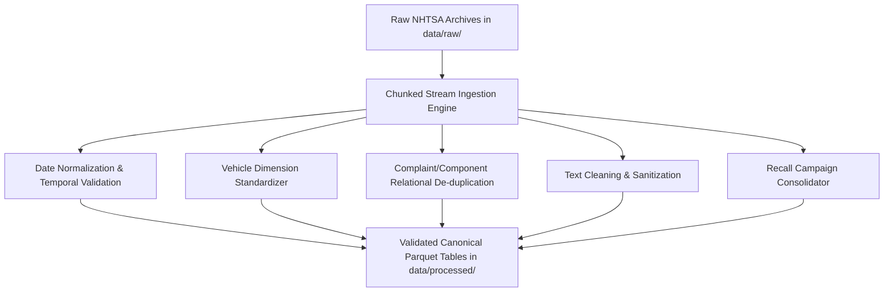

# DEFECTRADAR — Phase 1: Preprocessing & Data Pipeline Plan

**Project:** DEFECTRADAR  
**Hardware Profile:** MacBook Air M2 (8GB RAM, Apple Silicon, ARM64)  
**Execution Philosophy:** Chunked, low-memory streaming pipelines outputting compressed Parquet tables. Zero data leakage.

---

## 1. Overview of Preprocessing Pipeline

The preprocessing stage converts raw, denormalized, and noisy NHTSA flat files into structured, normalized, and validated Parquet files under `data/processed/`.

---

## 2. Component-by-Component Preprocessing Strategies

### 2.1 Date Normalization & Temporal Integrity
- **Raw Formats:** NHTSA dates are stored as 8-character string integers: `YYYYMMDD` (e.g. `20191221`).
- **Target Format:** Standard ISO-8601 date (`YYYY-MM-DD`).
- **Normalization Logic:**
  1. Validate length equals 8, all digits.
  2. Parse Year, Month, Day. Ensure $1900 \le \text{Year} \le 2026$, $1 \le \text{Month} \le 12$, $1 \le \text{Day} \le 31$.
  3. If invalid or corrupt (e.g. `00000000`, `99999999`, `19060622`), assign `NULL` (or for `LDATE`, flag record since received date is mandatory).
  4. **Temporal Ordering Sanity Check:** Ensure $\text{incident\_date} (\text{FAILDATE}) \le \text{received\_date} (\text{LDATE}) \le \text{date\_added} (\text{DATEA})$. If incident date is in the future relative to received date, set incident date to `NULL`.
- **Leakage Prevention Rule:**
  - For any backtest evaluated at simulated time $T_{\text{sim}}$, only complaints where $\text{received\_date} \le T_{\text{sim}}$ will ever be included.

### 2.2 Vehicle Hierarchy Normalization (Make, Model, Year)
- **Make Normalization:**
  - Convert to uppercase, strip leading/trailing whitespace.
  - Map corporate aliases to canonical brand names:
    - `HONDA (AMERICAN HONDA MOTOR CO.)` $\to$ `HONDA`
    - `FORD MOTOR COMPANY` $\to$ `FORD`
    - `GENERAL MOTORS, LLC` $\to$ `CHEVROLET` / `GMC` (resolve via `MAKETXT`)
    - `STELLANTIS` / `FCA US LLC` $\to$ `JEEP` / `RAM` / `DODGE` / `CHRYSLER`
    - `NISSAN NORTH AMERICA, INC.` $\to$ `NISSAN`
- **Model Normalization:**
  - Uppercase and clean whitespace.
  - Strip submodel/trim noise that creates artificial sparsity:
    - Example: `F-150 SUPERCREW`, `F-150 SUPERCAB`, `F150 4X4` $\to$ Base Model: `F-150`
    - Example: `SILVERADO 1500 LTZ`, `SILVERADO 1500 CREW` $\to$ Base Model: `SILVERADO 1500`
    - Example: `ACCORD HYBRID`, `ACCORD EX-L` $\to$ Base Model: `ACCORD` (preserve powertrain flag in separate attribute)
- **Model-Year Validation:**
  - Convert `YEARTXT` to 4-digit integer.
  - Values outside $[1985, 2026]$ or equal to `9999` are set to `NULL` / marked unassigned.

### 2.3 Complaint & Component Relationship (De-duplication)
- **The Pitfall:** In raw NHTSA data, if a consumer complaint mentions three components (e.g., Engine, Transmission, Electrical), NHTSA outputs three identical rows containing the full 2,000-character narrative, differing only by `CMPLID` and `COMPDESC`.
- **Deduplication Strategy:**
  1. Group incoming rows by `ODINO` (the unique complaint case number).
  2. The canonical complaint record (narrative, vehicle info, crash/fire flags, dates) is extracted once.
  3. All unique `COMPDESC` entries associated with that `ODINO` are extracted into child records linked to `ODINO`.
  4. Deduplication rule: Drop exact duplicate `(ODINO, COMPDESC)` rows if any occur, but **never** drop distinct components for the same complaint.

### 2.4 Text Cleaning & Sanitization (Pre-Embedding)
- **Raw Characteristics:**
  - Text is in all-caps (`CDESCR`).
  - Frequently contains redactions from NHTSA privacy screening (e.g., `*TR`, `*JB`, `*AK`, `*DT`).
  - Contains repetitive telephone/case boilerplate headers (e.g., `CONSUMER STATED THAT...`, `THE CALLER REPORTED...`, `VOQ CONTACT REPORT`).
- **Cleaning Actions:**
  1. Remove NHTSA redaction asterisks and clerk initials (`*TR`, `*JB`, etc.).
  2. Strip standard administrative prefix boilerplate while preserving actual symptom narrative.
  3. Normalize multiple whitespace, tabs, and stray control characters.
  4. Retain casing or normalize to natural capitalization for transformer tokenizers.
  5. Calculate and store `narrative_length` for quick quality filtering.

### 2.5 Safety & Severity Indicator Parsing
- **Flags:** Map `CRASH`, `FIRE`, `MEDICAL_ATTN`, `VEHICLES_TOWED_YN`, `POLICE_RPT_YN` from string `'Y'`/`'N'` to boolean `1`/`0`.
- **Counts:** Convert `INJURED` and `DEATHS` to unsigned integers, capping unreasonable data-entry errors.
- **Derived Severity Index:** Calculate an initial observation severity score:
  $$\text{Severity}_{\text{obs}} = w_{\text{crash}} \cdot \mathbb{I}_{\text{crash}} + w_{\text{fire}} \cdot \mathbb{I}_{\text{fire}} + w_{\text{injury}} \cdot \text{Injuries} + w_{\text{death}} \cdot \text{Deaths} + w_{\text{tow}} \cdot \mathbb{I}_{\text{tow}}$$

### 2.6 Recall Campaign Normalization (`FLAT_RCL`)
- **Consolidation:** Aggregate rows by `CAMPNO` (the 12-character NHTSA Campaign Number).
- Extract unique campaign-level metadata:
  - Earliest `RCDATE` (NHTSA report receipt date).
  - Earliest `ODATE` (owner notification date).
  - Maximum `POTAFF` (estimated total units affected).
  - Full defect description (`DESC_DEFECT`), consequence (`CONEQUENCE_DEFECT`), and corrective remedy (`CORRECTIVE_ACTION`).
- Store the set of affected vehicles `(MAKE, MODEL, YEARTXT)` in a dedicated relational lookup table `recall_vehicles.parquet`.

### 2.7 Investigation Normalization (`FLAT_INV`)
- Deduplicate on `NHTSA_ACTION_NUMBER` to establish the canonical investigation record.
- Extract `ODATE` as the primary milestone date.
- Match `CAMPNO` to safety recalls where present to establish ground-truth defect sequences:
  $$\text{Complaints Emerge} \longrightarrow \text{Investigation Opened } (ODATE) \longrightarrow \text{Recall Issued } (RCDATE)$$

---

## 3. Memory & Resource Budget (8GB RAM Target)

| Step | Processing Mode | Batch Size | RAM Footprint | Output Target |
| :--- | :--- | :--- | :--- | :--- |
| **Complaints Ingestion** | Chunked Stream (via generator) | 50,000 rows | < 250 MB | `data/processed/complaints.parquet` |
| **Components Ingestion** | Chunked Stream | 50,000 rows | < 150 MB | `data/processed/complaint_components.parquet` |
| **Recalls Ingestion** | Full Stream GroupBy | 50,000 rows | < 180 MB | `data/processed/recalls.parquet` |
| **Investigations Ingestion** | Full Stream GroupBy | 50,000 rows | < 120 MB | `data/processed/investigations.parquet` |
